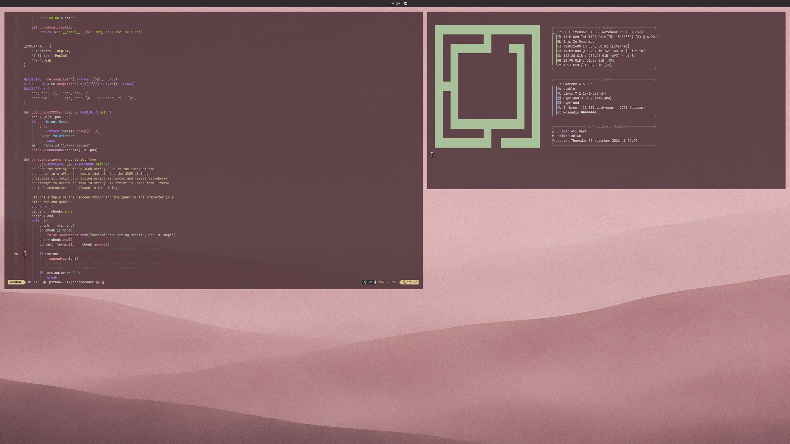

# Rosendis

A softly dark [Omarchy](https://omarchy.org) theme in dusty pastel pink, built around a misty landscape of rose-coloured hills.

*Rosendis* is Swedish for "rose haze".



## Install

```bash
omarchy theme install https://github.com/mewset/omarchy-rosendis-theme
```

## What's included

- `colors.toml` – the full palette. Omarchy generates the terminal, Neovim, btop, VS Code, Hyprland and shell colours from it.
- `backgrounds/` – one 3840×1600 background, which also crops well to 16:9.
- `chromium.theme` – a dusty plum seed colour, so Chromium gets a dark, rose-tinted UI.
- `icons.theme` – Yaru-magenta.
- `t3code.json` – a hand-tuned T3 Code palette covering every colour T3 Code exposes (sidebar, message bubbles, search highlights, warnings and more). Omarchy publishes it to T3 Code as the "Omarchy" theme while Rosendis is active.

## Palette

| Role | Colour |
|---|---|
| Background | `#332a2e` |
| Dark / darker background | `#2b2327` / `#231c20` |
| Lighter background | `#3f3439` |
| Selection | `#4f4047` |
| Foreground | `#ecdfdf` |
| Muted | `#87747c` |
| Accent | `#dba6ac` |
| Red / bright | `#df8a8e` / `#eba3a6` |
| Orange | `#dfa38a` |
| Yellow / bright | `#ddc391` / `#e8d3a9` |
| Green / bright | `#a9c19a` / `#bdd2b0` |
| Cyan / bright | `#98c0b8` / `#b0d2cb` |
| Blue / bright | `#a2b3d4` / `#b9c7e2` |
| Magenta / bright | `#cba3c6` / `#dbbad7` |

Body text has a contrast ratio of 10.7:1 against the background, and every syntax colour is above 5:1.

## Credits

The background was generated with ChatGPT and upscaled locally with [Real-ESRGAN](https://github.com/xinntao/Real-ESRGAN).

## License

MIT
